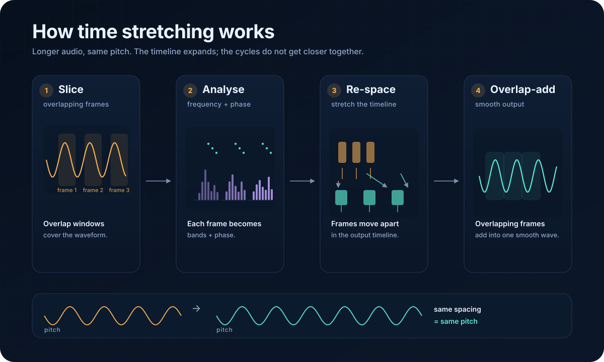

# Signalsmith Stretch — Rust

> Real-time, `no_std`-friendly time stretching and pitch shifting for desktop and embedded audio.

**No `unsafe`** · **`f32` + [`microfft`](https://crates.io/crates/microfft)** · **`no_std + alloc`** · **real-time ready** · **MSRV 1.97**

Package: `signalsmith-stretch-rs` · Crate: `signalsmith_stretch`

## Contents

- [Quick start](#quick-start)
- [How it works](#how-it-works)
- [`no_std`](#no_std)
- [Real-time and MCU/embedded](#real-time-and-mcuembedded)
- [Streaming](#streaming)
- [Controls](#controls)
- [CLI](#cli)
- [Verification](#verification)
- [License](#license)

## Quick start

```toml
[dependencies]
signalsmith-stretch-rs = "1.3"
```

```rust
use signalsmith_stretch::SignalsmithStretch;

fn main() {
    let sample_rate = 48_000.0_f32;
    let input_frames = 4_800;
    let output_frames = 7_200; // 1.5x

    let samples: Vec<f32> = (0..input_frames)
        .map(|i| {
            let phase = std::f32::consts::TAU * 220.0 * i as f32 / sample_rate;
            phase.sin() * 0.3
        })
        .collect();

    let input: [&[f32]; 1] = [&samples];
    let mut rendered = vec![0.0_f32; output_frames];
    let mut output: [&mut [f32]; 1] = [&mut rendered];

    let mut stretch = SignalsmithStretch::<f32>::with_seed(12345);
    stretch.preset_default(1, sample_rate, false);

    assert!(stretch.exact(&input, input_frames, &mut output, output_frames));
}
```

`exact()` performs the seek, process, and flush sequence. Pitch and formants stay unchanged unless you call `set_transpose_semitones` or `set_formant_semitones`.

Compiled example: [`examples/basic.rs`](examples/basic.rs) · [microphone demo](https://github.com/ioma8/signalsmith-stretch-rs/tree/main/examples/egui-mic).

## How it works



Time stretching changes **duration—and therefore tempo—but not pitch**.

1. **Slice + FFT** — overlapping snapshots become frequency bands and phases.
2. **Spread** — move snapshots apart and align their phase.
3. **IFFT + blend** — rebuild audio and overlap-add one longer sound.

Phase alignment keeps the cycles continuous; pitch shifting is a separate control.

## `no_std`

```toml
[dependencies]
signalsmith-stretch-rs = {
    version = "1.3",
    default-features = false,
    features = ["no_std"],
}
```

The `no_std` feature uses `alloc` and `libm`; the target needs a global allocator and atomic CAS for `Arc`. The CLI requires `std`. Use `with_seed()` for reproducible output; the no_std default seed is `0`.

## Real-time and MCU/embedded

`configure()` or a preset allocates all working buffers up front. After that, `process()`, `flush()`, and `seek()` are allocation-free and use no locks, threads, or I/O.

The `no_std` build targets bare-metal MCUs with `alloc` and atomics. `exact()` allocates a small channel vector; use `process()`/`flush()` in a real-time callback.

## Streaming

```rust
use signalsmith_stretch::SignalsmithStretch;

fn main() {
    let input = vec![0.1_f32; 600];
    let mut output = vec![0.0_f32; 1_500];

    let mut stretch = SignalsmithStretch::<f32>::with_seed(12345);
    stretch.configure(1, 576, 144, false);

    {
        let mut first = [&mut output[..900]];
        stretch.process(&[&input], 600, &mut first, 900);
    }
    {
        let mut tail = [&mut output[900..]];
        stretch.flush(&mut tail, 600, 1.0);
    }
}
```

Feed `input_latency()` samples ahead and read `output_latency()` samples behind the processing point.

## Controls

| Call | Purpose |
| --- | --- |
| `preset_default` | 120 ms block / 30 ms interval |
| `preset_cheaper` | 100 ms block / 40 ms interval |
| `configure` | Explicit block and interval |
| `set_transpose_semitones` | Pitch shift |
| `set_formant_semitones` | Formant shift |
| `set_formant_base` | Fundamental hint, or `0.0` for auto |
| `set_freq_map` | Custom frequency map |

Blocks are capped at 32,768 samples and 256 channels. FFT sizes round up to a power of two.

## CLI

```sh
cargo run --release --features cli --bin stretch -- \
    --time 1.5 --semitones 4 --tonality 8000 \
    input.wav output.wav
```

Preserves integer WAV bit depths and 32-bit float WAV. 64-bit float WAV is rejected explicitly.

## Verification

```sh
cargo test --all-targets --all-features
cargo clippy --all-targets --all-features -- -D warnings
cargo test --doc --all-features
cargo fmt --all -- --check
```

Bare-metal compile check:

```sh
cargo check --no-default-features --features no_std --lib \
    --target riscv32imac-unknown-none-elf
```

Benchmark:

```sh
cargo run --release --example bench
```

ESP32: see the [QEMU benchmark setup and results](docs/esp32-qemu-benchmark.md) — about **2× real-time** for 48 kHz stereo at 1.5× stretch under emulation.

Reference fixtures cover exact renders and streaming. `f32` FFT rounding is expected; zero-input calls guarantee finite output, not sample-for-sample equality.

## License

MIT. See [`LICENSE.txt`](LICENSE.txt).
