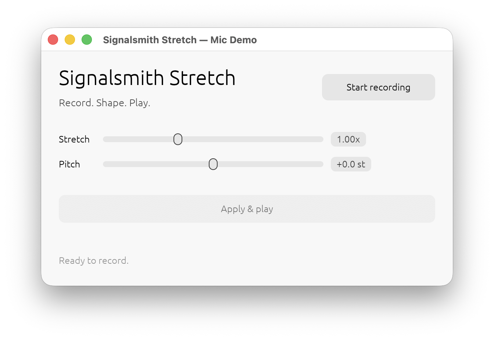

# Signalsmith Stretch — egui mic demo

A small desktop app for recording a phrase from the microphone, time-stretching
and pitch-shifting it with this repository's `signalsmith-stretch` library, then
playing the result.



## Run

From this directory:

```sh
cargo run --release
```

macOS will ask for microphone access on the first recording. If it was denied,
allow the terminal or the built app under **System Settings → Privacy & Security
→ Microphone**.

## Use

1. Press **Start recording** and speak or play into the mic.
2. Press **Stop recording**.
3. Set **Stretch** (0.1×–10×) and **Pitch** (−12–+12 semitones).
4. Press **Apply & play**.

The sliders are applied when **Apply & play** is pressed. Record again at any
time to replace the current take.

## Notes

- Mono microphone capture, up to 60 seconds, held in memory.
- Each take is peak-normalized to 0.95 before processing.
- The output device's sample rate is handled with linear resampling.
- The app uses the parent library crate through a path dependency: `../..`.
- The UI uses only the default egui light theme.
